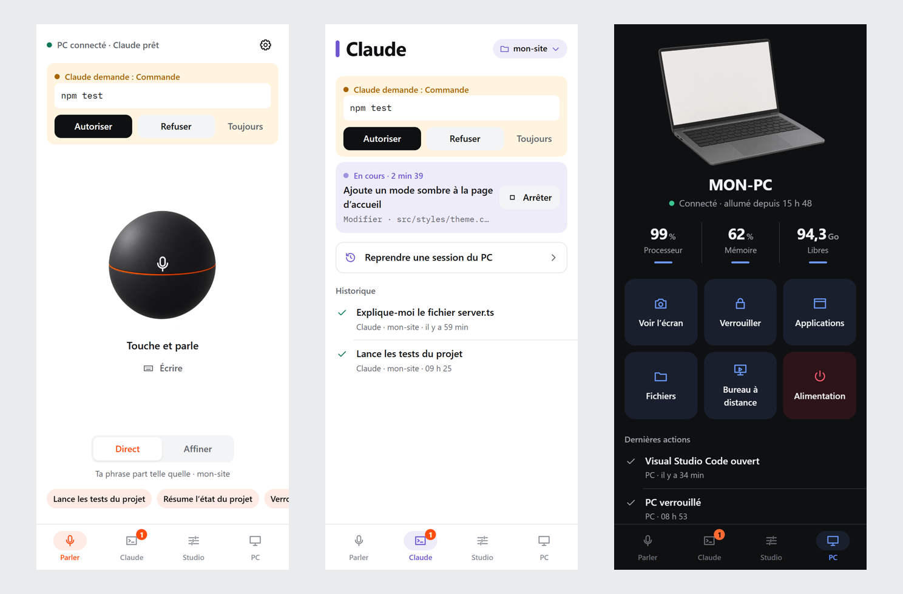
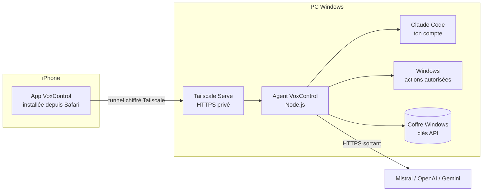

<p align="center">
  
</p>

<h1 align="center">VoxControl</h1>

<p align="center">
  <b>Pilote Claude Code et ton PC Windows depuis ton iPhone, à la voix.</b><br />
  Tu parles, ton PC agit. Tu valides chaque action sensible avec Face ID.
</p>

<p align="center">
  
</p>

<p align="center">
  <a href="docs/INSTALLATION.md"><b>Installer</b></a> ·
  <a href="docs/FONCTIONNALITES.md">Fonctionnalités</a> ·
  <a href="docs/ARCHITECTURE.md">Architecture</a> ·
  <a href="docs/SECURITE.md">Sécurité</a> ·
  <a href="CONTRIBUTING.md">Contribuer</a>
</p>

---

## Pourquoi VoxControl

Tu lances une tâche dans Claude Code, tu t'éloignes de ton bureau… et Claude attend ton accord pour lancer une commande. VoxControl te permet de :

- **dicter** une instruction à Claude Code depuis n'importe où, téléphone en main ;
- **autoriser ou refuser** les commandes de Claude depuis une notification ;
- **transformer une idée floue en prompt précis** avant de l'envoyer (mode Affiner) ;
- **piloter ton PC** : voir l'écran, verrouiller, ouvrir une application, récupérer un fichier, redémarrer.

Le tout **sans serveur, sans abonnement supplémentaire et sans ouvrir de port** : ton PC sert lui-même l'application, accessible seulement par ton réseau privé [Tailscale](https://tailscale.com).

## En un coup d'œil

| | |
|---|---|
| **Parler** | Une sphère au centre : tu touches, tu parles. Mode **Direct** (ta phrase part telle quelle) ou **Affiner** (une IA en fait un prompt précis). Transcription en direct possible. |
| **Claude** | Ce qui tourne (temps écoulé, étape en cours), ce qui attend ton accord, l'historique. Réponses mises en forme, **fichiers modifiés avec leurs différences**. |
| **Studio** | Ta demande passe par des étapes visibles : rédaction, prompt modifiable, relecture par une deuxième IA, envoi. |
| **PC** | Processeur, mémoire, disque ; capture d'écran affichée dans l'écran de l'ordinateur ; applications, fichiers, alimentation, bureau à distance. |
| **Sécurité** | Appairage par code, Face ID (passkeys) pour les actions sensibles, liste blanche, journal d'audit, clés API dans le coffre de Windows. |

Toutes les fonctions : [docs/FONCTIONNALITES.md](docs/FONCTIONNALITES.md).

## Comment ça marche



1. L'**agent** tourne sur ton PC (démarrage automatique, icône dans la zone de notification).
2. **Tailscale Serve** lui donne une adresse HTTPS privée, visible seulement par tes appareils.
3. L'**app** s'installe sur l'iPhone depuis Safari (« Sur l'écran d'accueil »), sans App Store.
4. L'agent pilote **Claude Code** par l'[Agent SDK](https://code.claude.com/docs) officiel, avec le compte déjà connecté sur ton PC. Chaque demande d'autorisation de Claude remonte sur ton téléphone.

Détails, diagrammes et API : [docs/ARCHITECTURE.md](docs/ARCHITECTURE.md).

## Installation rapide

**Il te faut :** Windows 10 ou 11, [Claude Code](https://code.claude.com) installé et connecté, un iPhone (iOS 16.4 ou plus récent), un compte [Tailscale](https://login.tailscale.com/start) gratuit.

```powershell
git clone https://github.com/NEXUXSTELAR/voxcontrol-app.git
cd voxcontrol-app
powershell -ExecutionPolicy Bypass -File scripts\install.ps1
```

Le script installe ce qui manque (Node.js, Tailscale), construit l'application, la publie sur ton réseau privé et crée le démarrage automatique. Ensuite, sur l'iPhone : Tailscale, puis l'app, puis un code d'appairage.

**Guide pas à pas, captures à l'appui : [docs/INSTALLATION.md](docs/INSTALLATION.md)** (environ 30 minutes la première fois).

## Combien ça coûte

| Poste | Coût |
|---|---|
| Tailscale (offre Personal), hébergement, App Store | 0 € |
| Claude Code | ton abonnement actuel |
| Dictée Voxtral (Mistral), environ 500 min par mois | ≈ 2 € |
| Mode Affiner (Mistral), 20 demandes par jour | ≈ 1 à 3 € |
| Deuxième avis (OpenAI ou Gemini), facultatif | ≈ 0,5 à 2 € |

Un **plafond mensuel** dans l'app coupe les appels aux IA au-delà de la limite que tu fixes. Sans clé Mistral, VoxControl fonctionne quand même : tu écris, ou tu dictes avec le clavier de l'iPhone.

## Sécurité, en bref

- Aucun port ouvert sur Internet : tout passe par le tunnel chiffré Tailscale.
- Chaque téléphone est appairé par un code à usage unique, et révocable.
- Les actions sont classées en 4 niveaux. Redémarrer, arrêter, envoyer un fichier, modifier les accès : **Face ID obligatoire**. Certaines actions restent interdites tant que tu ne les autorises pas.
- Les commandes et modifications de fichiers demandées par Claude **remontent pour accord**, même si ton Claude Code local les autorise d'office.
- Les clés API restent dans le Gestionnaire d'identification Windows, jamais dans le code, les journaux ni le téléphone.

Modèle de menace et réglages : [docs/SECURITE.md](docs/SECURITE.md). Signaler une faille : [SECURITY.md](SECURITY.md).

## Contribuer

VoxControl est offert à la communauté : idées, corrections et nouvelles fonctions sont les bienvenues. Commence par [CONTRIBUTING.md](CONTRIBUTING.md) : installation pour développer, organisation du code, conventions, et une liste d'idées pour se lancer.

```powershell
npm install
npm run build
npm test      # 10 tests de sécurité sur une copie isolée de l'agent
```

## Limites connues

- Windows uniquement côté PC (l'agent utilise PowerShell et le Gestionnaire d'identification Windows).
- Interface en français.
- Un PC éteint ou en veille ne répond pas ; il ne peut pas être rallumé à distance.
- iOS peut redemander l'accès au micro à chaque ouverture (limite des apps web) et ne permet pas de faire vibrer.
- L'usage de Claude Code par l'Agent SDK avec un abonnement est autorisé pour un **usage personnel** : chacun installe VoxControl pour lui-même, avec son propre compte.

## English summary

VoxControl lets you drive **Claude Code** and your **Windows PC** from your **iPhone**, by voice. A small Node.js agent runs on your PC and serves an installable web app over a private **Tailscale** HTTPS address (no open ports, no server). You dictate instructions, approve Claude's tool permissions from a notification, refine vague requests into precise prompts, and control your PC (screen, apps, files, power), with **Face ID** required for sensitive actions. The UI is in French; contributions (including translations) are welcome. See [docs/INSTALLATION.md](docs/INSTALLATION.md) and [CONTRIBUTING.md](CONTRIBUTING.md).

## Licence

[MIT](LICENSE). Les visuels 3D de l'app (ordinateur et sphère) ont été générés pour le projet et sont distribués avec lui.
