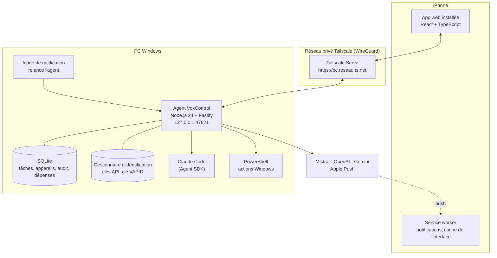
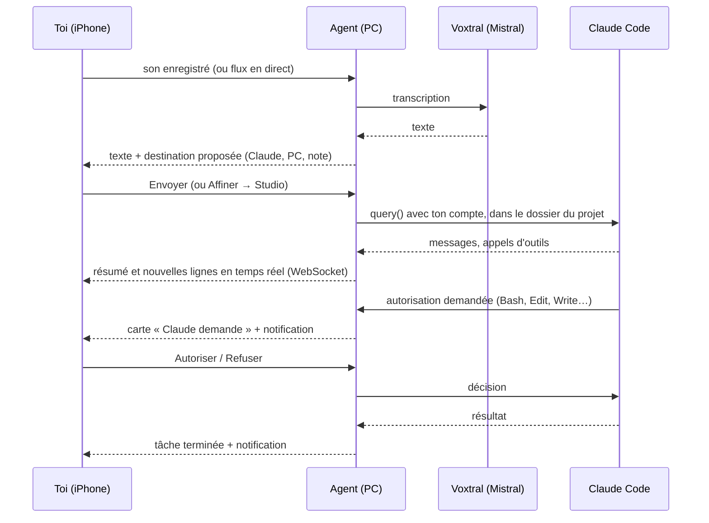

# Architecture

## Vue d'ensemble



- L'agent n'écoute que sur `127.0.0.1`. Seul Tailscale Serve le relie au réseau, et uniquement pour les appareils de ton compte Tailscale.
- Aucun service hébergé : l'app est servie par l'agent et mise en cache par le service worker.

## Le trajet d'une demande



## Organisation du code

```
agent/src/
  main.ts       routes HTTP, WebSocket, niveaux de risque, réglages
  auth.ts       appairage, jetons d'appareil, passkeys (Face ID), confirmations
  claude.ts     sessions Claude Code (Agent SDK), autorisations, fichiers touchés
  system.ts     mesures, applications, fenêtres, fichiers, alimentation, capture d'écran
  ai.ts         Voxtral, mode Affiner, deuxième avis, reconnaissance des commandes PC
  voice.ts      transcription en direct (relais WebSocket vers Voxtral temps réel)
  changes.ts    différences des fichiers modifiés (git diff)
  updater.ts    mise à jour (git pull, npm ci, build)
  bus.ts        tâches (« opérations »), résumés, diffusion du journal par morceaux
  db.ts         SQLite (node:sqlite)
  push.ts       notifications Web Push (VAPID)
  secrets.ts    coffre Windows (@napi-rs/keyring), masquage des clés dans les journaux
  config.ts     configuration (%LOCALAPPDATA%\VoxControl\config.json)

app/src/
  App.tsx       barre des 4 espaces, pile de feuilles, appairage
  spaces/       Parler, Claude, Studio, PC
  sheets/       feuilles : demande, tâche, confirmation Face ID, réglages, fichiers…
  api.ts        appels, temps réel, store
  recorder.ts   enregistrement micro et niveau sonore
  livevoice.ts  capture PCM 16 kHz (AudioWorklet) pour la transcription en direct
  speech.ts     préférences de l'appareil, lecture à voix haute
  styles.css    jetons de couleur et composants
  sw.ts         service worker

scripts/
  install.ps1     installation complète
  tray.ps1        icône de notification, relance de l'agent
  enable-rdp.ps1  bureau à distance limité à Tailscale

tests/agent.test.mjs  tests de sécurité sur une copie isolée de l'agent
```

## Choix techniques

| Choix | Pourquoi |
|---|---|
| Une seule page, sans changement d'adresse | iOS coupe le micro des apps web quand l'adresse change |
| TypeScript exécuté directement par Node 24 | aucune étape de compilation pour l'agent |
| `node:sqlite` | base intégrée à Node, rien à installer |
| Agent SDK plutôt que simuler le clavier | voie officielle, autorisations respectées, session suivie |
| Règles « ask » ajoutées par l'agent | les actions de Claude remontent au téléphone, même si les réglages locaux les autorisent |
| Passkeys (WebAuthn) pour confirmer | Face ID natif, aucun secret stocké sur le PC |
| Démarrage à l'ouverture de session (pas un service Windows) | un service ne peut ni ouvrir d'apps sur ton bureau ni capturer l'écran |
| Bibliothèques lourdes chargées à la demande | démarrage de l'agent en environ 5 s |

## API de l'agent

Toutes les routes `/api/*` exigent un jeton d'appareil (`Authorization: Bearer …`), sauf `/api/hello` et `/api/pair/claim`. Les routes de niveau 2 exigent en plus l'en-tête `X-Vox-Stepup` (confirmation Face ID valable une fois, 90 s). Depuis le PC lui-même (`localhost`, sans proxy), aucun jeton n'est demandé.

| Route | Rôle |
|---|---|
| `GET /api/hello` | état public minimal |
| `POST /api/pair/start` · `POST /api/pair/claim` | appairage (le premier : PC seulement) |
| `GET /api/state` | état complet : mesures, tâches (résumés), réglages, appareils |
| `WS /ws` | temps réel : `op` (résumé), `log` (nouvelles lignes), `metrics` |
| `WS /ws/voice` | transcription en direct (PCM 16 bits, 16 kHz) |
| `POST /api/voice` | transcription d'un enregistrement |
| `POST /api/suggest` · `/api/refine` · `/api/second-opinion` | destination proposée, Affiner, relecture |
| `POST /api/claude/send` · `/decide` · `/stop` · `GET /api/claude/sessions` | Claude Code |
| `GET /api/ops/:id` · `GET /api/ops/:id/diff` | journal complet et fichiers modifiés d'une tâche |
| `POST /api/action` | actions Windows (niveaux 0 à 3) |
| `GET /api/files` · `/api/files/download` · `POST /api/files/upload` | fichiers des dossiers autorisés |
| `GET /api/pc/screenshot` · `/screenshot/last` | capture d'écran |
| `POST /api/settings` · `/api/settings/security` · `/api/keys/:fournisseur` | réglages, accès, clés |
| `GET /api/update/check` · `POST /api/update` | mise à jour |
| `POST /api/passkey/*` · `/api/stepup/*` · `/api/push/*` | Face ID et notifications |

## Données sur le PC

| Quoi | Où |
|---|---|
| Configuration (sans secret) | `%LOCALAPPDATA%\VoxControl\config.json` |
| Tâches, appareils, audit, dépenses | `%LOCALAPPDATA%\VoxControl\voxcontrol.db` |
| Clés API, clé privée VAPID | Gestionnaire d'identification Windows, service « VoxControl » |
| Journaux | `agent.log`, `tray.log` dans le même dossier |

Variables d'environnement utiles pour développer : `VOX_PORT`, `VOX_DATA_DIR`, `VOX_KEYRING`.
