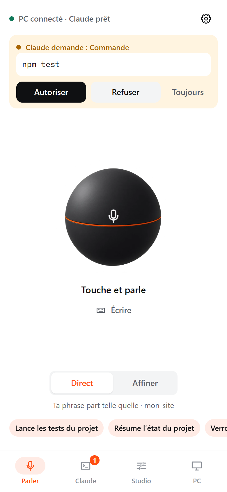
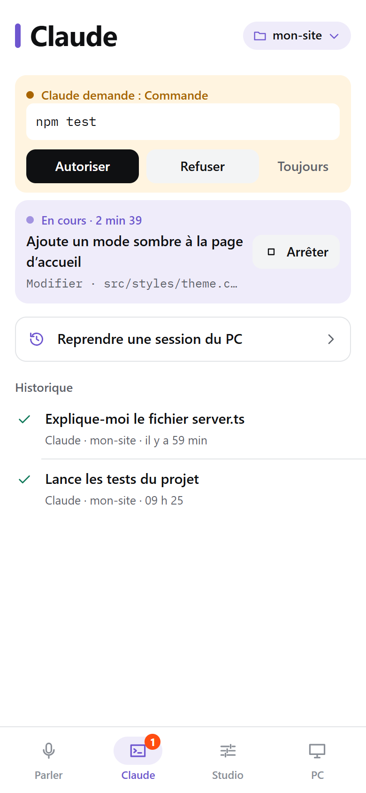
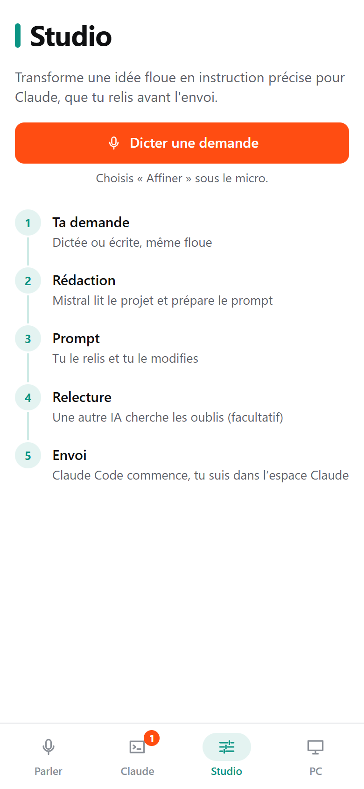
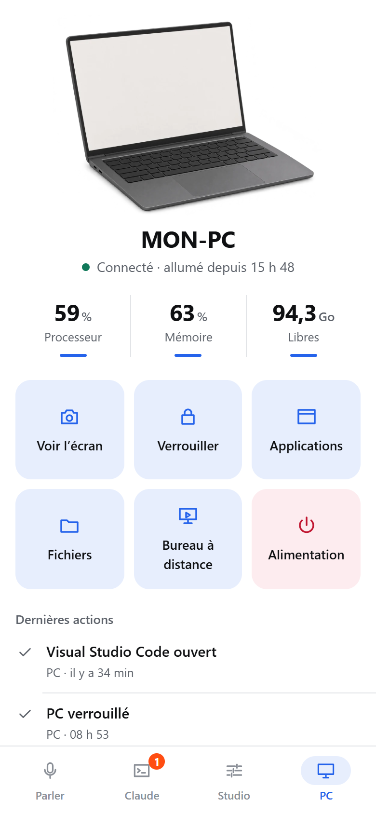

# Fonctionnalités

## Parler

- **Une sphère au centre** : touche, parle, touche de nouveau. L'anneau orange suit le volume réel de ta voix.
- **Direct** : ta phrase part telle quelle. **Affiner** : une IA la transforme d'abord en prompt précis (voir Studio).
- **Destination proposée** : VoxControl reconnaît les commandes Windows (« verrouille le PC », « ouvre VS Code ») et range le reste vers Claude. Tu peux changer la destination : Claude, PC, ou simple copie.
- **Envoi automatique** : une demande courte et claire part après 3 secondes ; toucher l'écran annule.
- **Transcription en direct** (option) : le texte s'écrit pendant que tu parles.
- **Suggestions apprises** : les 3 raccourcis sous la sphère deviennent tes demandes les plus fréquentes.
- **Suite de session** : continue une conversation Claude existante au lieu d'en ouvrir une nouvelle.
- Sans clé Mistral : tu écris, ou tu dictes avec le micro du clavier de l'iPhone.

 

## Claude

- **En cours** : temps écoulé, étape actuelle (« Modifier · src/styles/theme.css »), bouton Arrêter.
- **T'attend** : quand Claude veut lancer une commande ou modifier un fichier, une carte apparaît avec la commande exacte : Autoriser, Refuser, ou Toujours (pour la session). Une notification arrive aussi.
- **Historique** des tâches, avec le détail : ce que tu as demandé, les outils utilisés, la réponse **mise en forme** (titres, listes, code).
- **Fichiers modifiés** : la liste des fichiers touchés par Claude et les lignes ajoutées ou retirées (dans un dépôt Git).
- **Projets** : le dossier dans lequel Claude travaille, avec des consignes permanentes par projet.
- **Reprendre une session du PC** : toutes les sessions Claude Code de ton ordinateur, y compris celles lancées au terminal.

 

## Studio

Pour les demandes floues (« améliore le design et vérifie que tout marche ») :

1. **Ta demande**, telle que dictée.
2. **Rédaction** : Mistral (ou l'IA choisie) lit l'arborescence, le README et le CLAUDE.md du projet (jamais les fichiers `.env`) et rédige un prompt avec objectifs, étapes, fichiers concernés et risques. S'il manque une information, il pose la question.
3. **Prompt** : tu le relis et le modifies.
4. **Relecture** (facultative) : OpenAI ou Gemini cherche les oublis ; tu coches les remarques à ajouter.
5. **Envoi** à Claude Code.

Coût affiché pour chaque rédaction.

 

## PC

- **État** : en ligne, durée d'allumage, processeur, mémoire, espace disque, batterie.
- **Voir l'écran** : capture en une seconde, affichée ensuite dans l'écran de l'ordinateur.
- **Verrouiller** le PC.
- **Applications** : ouvrir celles de ta liste, voir et fermer les fenêtres ouvertes.
- **Fichiers** : parcourir les dossiers autorisés, télécharger vers l'iPhone, envoyer depuis l'iPhone, ouvrir un dossier sur le PC.
- **Bureau à distance** : via l'app Windows App de Microsoft, à travers Tailscale.
- **Alimentation** : veille, redémarrer ou arrêter (annulable pendant 60 secondes, avec une pastille sur l'onglet PC).
- **Scripts autorisés** : tes propres scripts `.ps1`, `.bat` ou `.cmd`, lancés avec Face ID.

 

## Réglages

- **Connexions** : Mistral, OpenAI, Gemini (avec le lien officiel, l'aide et un test de connexion), état de Claude Code, Tailscale et du bureau à distance.
- **Affichage et voix** : thème clair, sombre ou auto, envoi automatique, transcription en direct, lecture à voix haute des résultats, icône claire ou sombre.
- **Cet appareil** : Face ID, notifications.
- **Appareils** : appairer, voir, révoquer.
- **Sécurité** : actions interdites, dossiers, applications et scripts autorisés.
- **Dépenses** : coût du mois par fournisseur et plafond mensuel.
- **Mise à jour** en un bouton, **journal** des actions, **recherche** de toutes les actions (Ctrl + K sur le PC).

## Sur le PC

- Icône dans la zone de notification : ouvrir, appairer un téléphone, voir le journal, redémarrer l'agent.
- L'agent est relancé automatiquement s'il s'arrête ; l'icône est vérifiée toutes les 5 minutes.
- Sur un grand écran, l'app affiche le contenu à gauche et le détail à droite.

Captures réalisées avec des données de démonstration.
