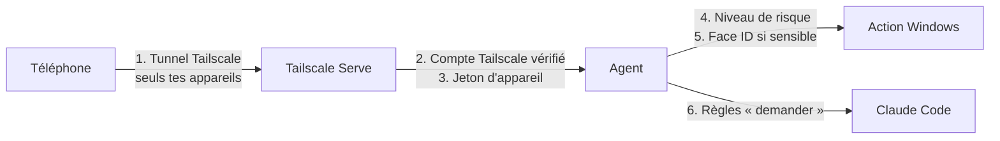

# Sécurité

VoxControl donne à un téléphone la main sur un PC et sur une IA capable d'écrire du code. La sécurité passe donc avant tout le reste. Ce document explique ce qui est protégé, comment, et ce qui reste de ta responsabilité.

## Les couches de protection

1. **Réseau** : l'agent écoute seulement sur `127.0.0.1`. Seul Tailscale Serve le publie, et uniquement sur ton réseau Tailscale. Aucun port n'est ouvert sur ta box ni dans le pare-feu.
2. **Compte Tailscale** : au premier appairage, l'agent retient ton identifiant Tailscale ; un autre compte est refusé, même avec un jeton valide.
3. **Appareil** : chaque téléphone reçoit un jeton aléatoire de 256 bits, stocké sous forme d'empreinte sur le PC. L'appairage se fait avec un code de 6 caractères, valable 5 minutes, avec 5 essais au plus. Chaque appareil est révocable.
4. **Niveaux de risque** : chaque action a un niveau, vérifié par le PC.
5. **Face ID** : les actions de niveau 2 exigent une confirmation par passkey (WebAuthn), valable une seule fois pendant 90 secondes.
6. **Claude Code** : l'agent ajoute des règles « demander » pour Bash, PowerShell, Edit, Write, NotebookEdit, WebFetch et les outils MCP. Elles passent avant les autorisations de ton installation locale : chaque commande ou modification remonte au téléphone.

## Les niveaux d'action

| Niveau | Exemples | Règle |
|---|---|---|
| 0 Consultation | état, capture d'écran | immédiat |
| 1 Sans risque | verrouiller, ouvrir une app de la liste, ouvrir un dossier autorisé | immédiat, journalisé |
| 2 Sensible | redémarrer, arrêter, veille, fermer une fenêtre, lancer un script, envoyer un fichier, révoquer un appareil, supprimer une clé, modifier les accès, mettre à jour | Face ID obligatoire |
| 3 Interdit par défaut | forcer la fermeture d'un processus | désactivé ; réactivable action par action, avec Face ID |

Il n'existe **aucune** commande PowerShell libre depuis le téléphone. Une phrase dictée ou une réponse d'IA ne peut déclencher qu'une action de cette liste, après vérification de son niveau : un texte piégé lu par une IA ne peut donc pas lancer de commande.

## Les secrets

- Les clés API sont saisies dans l'app, envoyées une seule fois au PC par le tunnel chiffré, puis rangées dans le **Gestionnaire d'identification Windows**.
- Seuls les 4 derniers caractères sont ensuite affichés. Les clés ne sont jamais renvoyées au téléphone ni écrites dans les journaux (masquage automatique).
- La clé privée des notifications (VAPID) est aussi dans le coffre ; seule la clé publique est sur le disque.

## Fichiers

- Le téléphone ne voit que les **dossiers autorisés** (Bureau, Documents, Téléchargements par défaut), modifiables avec Face ID.
- `blockedDrives` dans `config.json` exclut des lecteurs entiers, par exemple `["D:"]`.
- Envoyer un fichier vers le PC exige Face ID ; un fichier existant n'est jamais écrasé.

## Ce qui reste de ta responsabilité

| Risque | Conseil |
|---|---|
| Quelqu'un prend ton compte Tailscale | active la **double authentification** sur le compte qui sert à Tailscale (Google, Microsoft ou GitHub) |
| Ton téléphone est perdu | révoque-le depuis le PC : Réglages › Appareils › Révoquer |
| Une clé API fuit ailleurs | change-la chez le fournisseur, puis dans VoxControl ; fixe des plafonds de dépense |
| Tu autorises « Toujours » trop vite | « Toujours » vaut pour toute la session Claude : réserve-le aux commandes que tu connais |

## Tests

`npm test` lance une copie isolée de l'agent (autre port, autre dossier de données, autre coffre de clés) et vérifie : accès refusé sans appairage, appairage réservé au PC, mauvais code refusé, autre compte Tailscale refusé, Face ID exigé pour les actions sensibles, actions interdites, dossiers hors liste et lecteurs bloqués, journaux absents des listes, clés jamais renvoyées, révocation effective.

## Signaler une faille

Voir [SECURITY.md](../SECURITY.md). Merci de ne pas ouvrir d'issue publique pour une faille.
